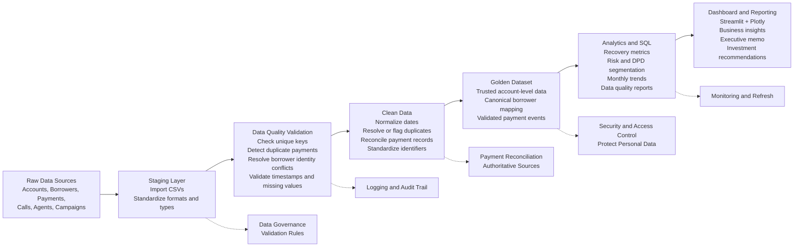

# CredResolve — Data Pipeline Architecture

## Overview

The pipeline transforms raw operational data into trusted datasets, recovery metrics, and business recommendations.

## Pipeline Responsibilities

1. **Raw data:** Preserve original source files for traceability.
2. **Staging:** Import data and standardize formats without losing source information.
3. **Validation:** Identify missing values, duplicate identifiers, conflicting borrower records, and timestamp problems.
4. **Clean data:** Normalize formats and reconcile records using documented rules.
5. **Golden dataset:** Maintain trusted, analysis-ready records with clearly defined keys.
6. **Analytics:** Calculate recovery metrics and analyze trends, risk segments, and delinquency.
7. **Reporting:** Present findings in the dashboard and executive memo.

## Important Controls

- Never assume a repeated payment reference proves a duplicate transaction.
- Do not join borrower records until identity conflicts have been resolved or explicitly handled.
- Preserve raw data and record every transformation.
- Calculate recovery rates using validated payment amounts and an appropriate outstanding-balance denominator.
- Clearly label incomplete reporting periods and unverified business claims.

## Current Evidence Limitation

The available payment data ends on August 8, 2026. The available evidence does not establish the claimed 11% month-on-month recovery improvement.